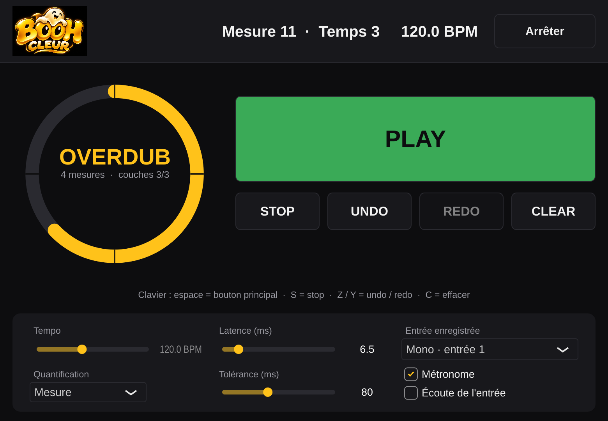

<p align="center"></p>

# BOOHcleur

Looper guitare multipiste avec **Smart Quantize** : il corrige le placement des attaques à l'intérieur d'une prise audio, sans jamais modifier l'enregistrement original. Il est prévu en application autonome (Standalone) et en plugins VST3 et AU, entièrement pilotable au MIDI, et à porter ensuite, éventuellement en version allégée, sur la [Tête NAM](https://github.com/NoSaga0717/tete-nam) (moteur [stompbox](https://github.com/NoSaga0717/stompbox) sur Raspberry Pi 5).

## Où on en est

J2 : une boucle jouable dans une application Standalone (Mac et Windows) : enregistrement quantifié à la mesure, lecture, overdubs en couches, undo/redo, métronome, latence réglable à la main. L'architecture est dans [`docs/adr/0001-architecture.md`](docs/adr/0001-architecture.md). Prochain jalon : J3, pilotage au pied en MIDI.

| Document | Contenu |
| --- | --- |
| [`docs/cahier-des-charges.md`](docs/cahier-des-charges.md) | Cahier des charges de référence (V1 à V4) |
| [`docs/adr/`](docs/adr/README.md) | Décisions d'architecture (ADR), une par fichier |
| [`AGENTS.md`](AGENTS.md) | Règles pour les IA qui travaillent sur le dépôt |

<p align="center"></p>

## Essayer l'application (Mac)

1. Ouvrir la dernière exécution réussie de la CI (onglet **Actions** du dépôt), télécharger l'artefact **BOOHcleur-macOS** et dézipper : on obtient `BOOHcleur.app` (binaire universel Intel et Apple Silicon).
2. L'app n'est pas signée par un compte développeur Apple : macOS la bloque au premier lancement. Dans le Terminal :
   ```bash
   xattr -dr com.apple.quarantine ~/Downloads/BOOHcleur.app
   ```
   (adapter le chemin), puis double-cliquer.
3. Accepter l'accès au micro (c'est l'entrée de la carte son). Dans **Options > Audio/MIDI Settings**, choisir la carte son et la taille de buffer. Dans l'app, **Entrée enregistrée** : « Mono · entrée 1 » (défaut) pour une guitare branchée sur l'entrée 1, jouée des deux côtés ; « Stéréo » pour un multi-effet stéréo.
4. Si un bandeau indique que l'entrée est coupée pour éviter le larsen, cliquer dessus pour la réactiver.

Utilisation : **espace** (ou le gros bouton) enregistre, ferme la prise, lance un overdub, le ferme. **S** arrête, **Z / Y** annulent ou rétablissent une couche, **C** efface. Les départs et fins de prise tombent sur la mesure ; un appui jusqu'à 80 ms après la barre de mesure est recadré dessus (réglable). La latence se règle à la main pour l'instant (environ : taille de buffer × 2 ÷ fréquence, plus quelques ms) ; la calibration automatique arrive en J7.

## Compiler et tester

Il faut CMake 3.22 ou plus récent et un compilateur C++20 (GCC 11+, Clang 14+, MSVC 2022).

```bash
cmake -S . -B build -DCMAKE_BUILD_TYPE=Release
cmake --build build -j
ctest --test-dir build --output-on-failure
```

Les tests utilisent Catch2, téléchargé automatiquement par CMake au premier configure.

Application (télécharge JUCE 8 au premier configure) :

```bash
cmake -S . -B build -DCMAKE_BUILD_TYPE=Release -DBOOHCLEUR_BUILD_APP=ON
cmake --build build -j
```

Sur Mac, ajouter `-DCMAKE_OSX_ARCHITECTURES="arm64;x86_64"` pour un binaire universel. Sous Linux, JUCE demande `libasound2-dev libfreetype-dev libfontconfig1-dev libx11-dev libxrandr-dev libxinerama-dev libxcursor-dev libxext-dev`.

Capture de l'interface sans carte son (développement) : option `-DBOOHCLEUR_BUILD_SCREENSHOT=ON`, puis `boohcleur-screenshot sortie.png overdub` (scénarios : `overdub`, `armed`, `recording`, `empty`).

## Organisation

- `core/` : `boohcleur-core`, le moteur commun. C++20 et bibliothèque standard uniquement, sans JUCE ni dépendance à l'OS.
- `app/` : enveloppe JUCE (Standalone ; VST3 et AU en J6) et interface.
- `tests/` : tests automatisés, dont un banc hors ligne qui fait tourner le moteur bloc par bloc.
- Les autres modules (analyse, rendu, contrôle, sessions, enveloppes JUCE, adaptateur stompbox) seront créés à leur jalon, voir l'ADR 0001.

## Licence

GPLv3, voir [`LICENSE`](LICENSE).
